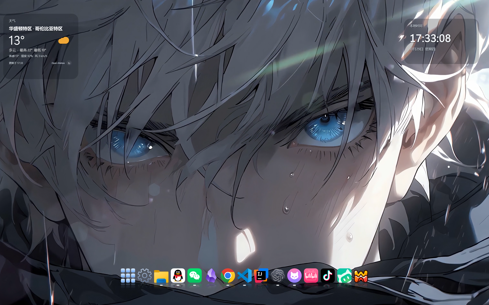
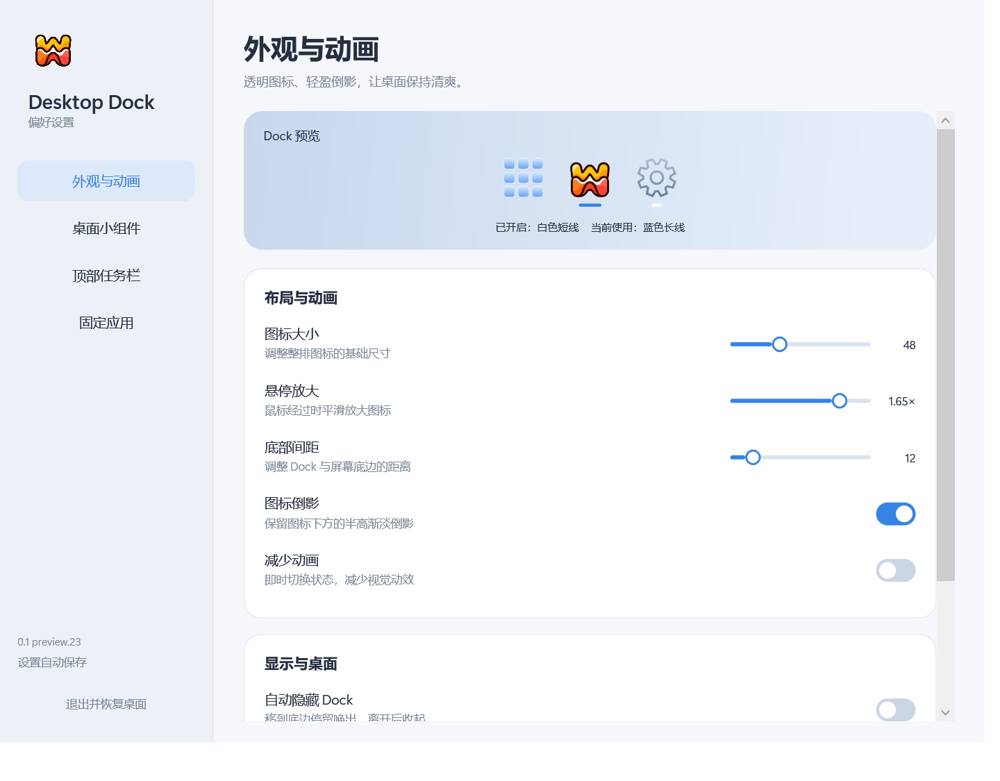
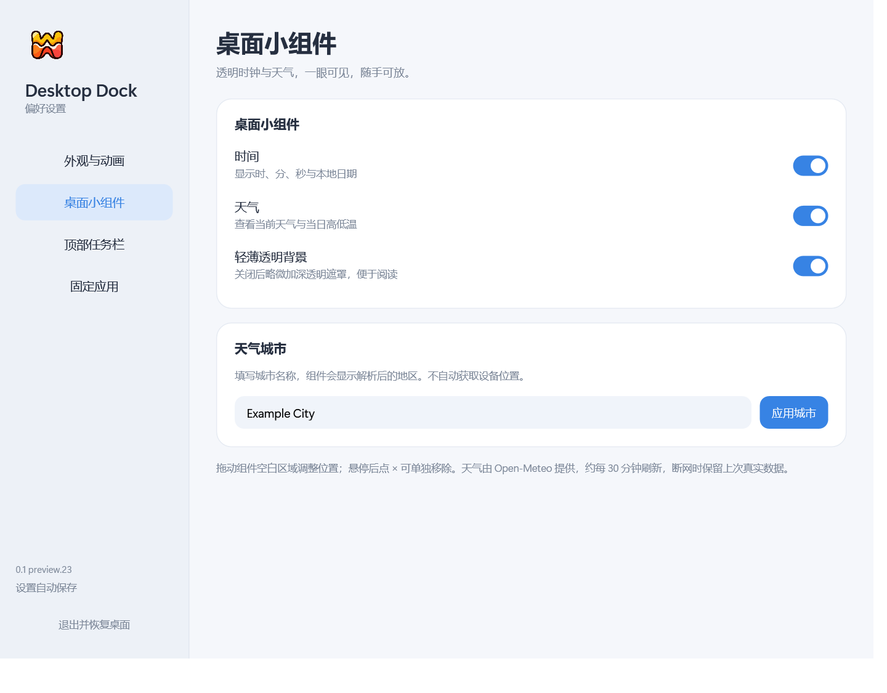

<p align="center">
  
</p>

<h1 align="center">Desktop Dock</h1>

<p align="center">
  让 Windows 桌面简洁、有序。
  <br>
  透明图标、轻盈倒影与连续悬停动画，打造 macOS 风格的桌面 Dock。
</p>

<p align="center">
  <strong>Windows 11 · x64 · 原生桌面应用</strong>
</p>

<p align="center">
  <a href="https://github.com/lpd2005/desktop-dock/releases">下载软件</a>
  &nbsp;·&nbsp;
  <a href="docs/USER_GUIDE.md">使用说明</a>
  &nbsp;·&nbsp;
  <a href="CHANGELOG.md">更新记录</a>
  &nbsp;·&nbsp;
  <a href="https://github.com/lpd2005/desktop-dock/issues">反馈问题</a>
</p>

---

## 界面预览 · Preview



| 外观与动画 | 桌面小组件 |
| :---: | :---: |
|  |  |

桌面效果与设置界面预览；图标、布局与组件可在设置中调整。

## 下载与安装 · Install

请前往 [Releases 发布页面](https://github.com/lpd2005/desktop-dock/releases) 下载。当前为 **0.1.0-preview.23 测试版**，尚未发布稳定版本。

支持 **Windows 11 22H2 或更新版本、x64**，目前以主显示器为主要支持范围。运行包自带 .NET，无需额外安装运行时。

| 下载方式 | 适合的使用方式 | 下载 |
| :--- | :--- | :--- |
| Windows 安装包（推荐） | 按向导安装，提供开始菜单入口与卸载，仅为当前用户安装 | [Setup-x64.exe](https://github.com/lpd2005/desktop-dock/releases/download/v0.1.0-preview.23/DesktopDock-0.1.0-preview.23-Setup-x64.exe) |
| 便携版 | 完整解压后运行 `DesktopDock.exe` | [win-x64.zip](https://github.com/lpd2005/desktop-dock/releases/download/v0.1.0-preview.23/DesktopDock-0.1.0-preview.23-win-x64.zip) |

安装后，在 **设置 → 启动与更新** 中开启登录后自启、检查和下载安装更新；自启默认关闭，升级保留已有配置。具体操作见 [使用说明](docs/USER_GUIDE.md)。

**注意** 该软件占用后台内存约为 **70M**

> 当前安装包暂未签名，Windows 可能显示“未知发布者”。请从本仓库的 Releases 下载，并可使用附件中的 `SHA256SUMS.txt` 核对文件。

## 已实现

- 透明悬浮图标、保留原图标轮廓、完整镜像的半高渐淡倒影。
- 连续放大波形、悬停名称、图标拖动排序、应用和文件夹入口。
- 设置窗口、托盘、可选自动隐藏；正常退出恢复原桌面图标状态。
- 设置和应用图标按任务栏方式切换：活动窗口再次点击最小化，后台窗口点击激活，已最小化窗口点击恢复。
- “启动与更新”提供当前用户开机自启、每日低频版本检查、下载校验和启动安装向导；升级保留用户配置。安装包提供开始菜单入口和卸载。
- 未运行或尚未识别到窗口的应用，单击不启动，双击启动；双击速度跟随 Windows 设置。Dock 设置仍为单击打开，右键菜单的“打开”可直接启动。
- 普通浏览器入口复用已打开的窗口，包括在 Dock 启动前已打开的浏览器；Chrome 快捷方式的启动来源标记不会误判为独立窗口参数。
- 悬停已运行应用约 0.4 秒显示不透明窗口预览卡片；每张卡片独立悬停高亮，点击切换或恢复指定窗口，多个窗口支持滚轮 / 按钮翻页。设置中可关闭预览。
- 已打开的应用显示白色短横线；当前活动应用使用更长的蓝色横线，最小化后仍保留标记。不增加图标背景板。状态变化短暂过渡，支持“减少动画”。
- Dock 最左侧的九宫格展开透明桌面面板，支持搜索、图标悬停缩放、滚轮分页、自动分类、本地分组、拖到分组和右键固定；分组不移动原文件。
- 透明时间和天气小组件，可拖动、保存位置和分别关闭；时钟显示秒数，天气默认洛阳市（河南），城市可修改，不自动定位。已移除日历组件。
- 使用透明背景的黄橙双波 Logo 作为程序、设置与托盘图标；设置采用浅色分栏、卡片、开关和 Dock 预览。
- 悬停时的普通按下、松开和双击保持图标放大，避免两次点击之间缩回；真正开始拖拽时才使用原始图标大小。
- 点击时图标在当前悬停大小上轻缩约 6%，松开后平滑回弹；倒影同步缩放，相邻图标和点击区域保持稳定。“减少动画”可关闭按压反馈。
- 右键应用图标可“关闭窗口”或“从 Dock 移除”；关闭窗口保留应用自己的保存 / 取消处理。
- 其他应用窗口覆盖 Dock 基础区域时自动隐藏；Dock 自身设置和对话框不触发遮挡隐藏。不再移动或缩放应用窗口。
- 主屏底边停留约 0.2 秒唤出；停留在图标或菜单上保持显示，移开约 0.75 秒收起。
- 收放使用短暂的上滑淡入 / 下滑淡出，可平滑反向，结束后停止更新；“减少动画”可关闭过渡。
- 桌面快捷方式拖入固定；Dock 内拖动排序，拖离较远时图标右下角显示红色垃圾桶，松手移除入口；拖回取消，原文件保持不变。
- Dock 和设置均不进入 Alt+Tab；切换期间抑制显示，等待稳定后再恢复。
- 原生窗口区域裁剪，Dock 外的透明区域不阻挡其他进程的鼠标交互。
- 可选的顶部原生任务栏增强：顶边停留唤出、移开收起、玻璃背景和独立异常退出恢复。
- 桌面恢复命令及独立进程的输入区域、全屏与动画调度回归检查。

原生任务栏的位置由用户在 Windows 中设置。任务栏增强目前仅处理主屏顶部任务栏；不自动移动任务栏。首期支持 Windows 11 22H2 或更新版本、x64、主显示器与常见显示缩放，顶部任务栏还要求系统或现有工具已支持该位置。

## 使用与恢复

首次正常运行会按设置隐藏桌面图标，退出时恢复。[使用说明](docs/USER_GUIDE.md) 同时随安装包和便携包提供。

在“设置 → 启动与更新”中启用登录后自启，默认关闭；若 Windows 禁用了启动项，需要在系统“启动应用”中开启。该设置只作用于当前用户，不提升进程优先级。更新检查默认每天最多一次，也可手动检查；不会自动下载或安装。用户选择下载安装后启动安装向导，保留固定应用、分组和组件设置。测试版接收后续测试版和正式版，正式版默认只接收正式更新。

双击包内的“安全预览.cmd”可查看效果与设置，不自动隐藏桌面图标，也不保存预览中的设置修改。正常使用请关闭预览后再启动 DesktopDock.exe。

异常结束后，可双击“恢复桌面.cmd”，或运行：

```powershell
.\DesktopDock.exe --recover
```

托盘菜单提供显示 Dock、设置、任务栏唤出、恢复和退出入口。遮挡时，将鼠标移动到主屏物理底边并稍作停留即可唤出 Dock；不再注册全局召回快捷键。

## 顶部原生任务栏增强

在 Windows 中将主屏任务栏设置到顶部，然后进入 Dock 设置，勾选“启用任务栏增强”。自动隐藏与玻璃效果可分别关闭；默认不接管原生任务栏。

鼠标在主屏最顶部两像素内停留约 0.18 秒唤出任务栏，离开约 0.75 秒收起。隐藏后点击任务栏原先占用的下方区域不会唤出；收放时只有已露出的部分保留悬停 / 点击响应。开始菜单、搜索和托盘菜单交互期间保持可用；也可通过设置或托盘临时唤出。没有覆盖整条顶部的透明鼠标窗口。启用自动隐藏时临时释放本任务栏预留的顶部工作区，唤出后任务栏覆盖在应用上方；收放只切换任务栏呈现，不调用窗口显示 / 隐藏或反复改变工作区，避免让最大化窗口缩小并留下顶部空白。新建 / 重新最大化的窗口使用当前工作区。

玻璃效果明暗跟随“浅色任务栏玻璃”。完整运行包附带经过 SHA-256 校验的官方 TranslucentTB 2026.2 便携组件，作为独立进程按需运行，不安装服务、不添加启动项。其源码、GPLv3 许可证与来源说明位于 components/TranslucentTB；本软件不接管用户已经运行的其他 TranslucentTB 实例。

正常退出、关闭增强或点击“恢复任务栏”都会恢复原来的显示和工作区状态。独立恢复进程处理 Dock 意外结束；也可双击“恢复任务栏.cmd”或运行 `DesktopDock.exe --recover-taskbar`。原来的 `--recover` 同时尝试恢复桌面图标与任务栏。显示器、任务栏位置或资源管理器变化后停止增强，需重新启用；不覆盖其他程序新设的不同工作区。

安全预览默认不启用任务栏增强；在预览设置中主动启用时会临时改变原生任务栏，退出后恢复。这些修改不保存。此功能已在 Windows 11 26H2 的主屏顶部任务栏验证，其他构建、第三方任务栏工具及多屏组合仍需继续兼容测试。

底边触发只读取鼠标位置，没有整条底边的透明鼠标拦截窗口。Dock 隐藏时两个窗口都收起；显示时独立的透明绘制窗口不接收输入，仅图标一带的输入区域响应鼠标。新增图标改变输入区域时，绘制窗口保持不变，避免整排画面闪烁。

文件管理器的普通点击不会唤出 Dock。桌面 / 文件管理器中实际拖动项目并靠近 Dock 一带时才提前显示，方便拖入；单纯捕获鼠标、轻微抖动或在远处选择项目不会触发。

## 从源码构建

安装 [.NET 10 SDK](https://dotnet.microsoft.com/download/dotnet/10.0)，在仓库根目录运行：

```powershell
dotnet build DesktopDock.slnx -c Release -m:1
dotnet run --project tests/DesktopDock.Checks -c Release
dotnet run --project src/DesktopDock.App -c Release -- --preview --settings
```

需要任务栏玻璃组件时，先运行 `scripts/Prepare-TaskbarGlass.ps1`，再构建。脚本从官方固定版本下载，校验后放入忽略的 .tools 目录；可通过 `-Proxy` 传入当前环境所需代理。打包脚本会自动准备组件。只有构建 Dock 和隐藏功能时无需下载组件。

生成自包含运行包：

```powershell
powershell -ExecutionPolicy Bypass -File scripts/Package.ps1
```

脚本优先使用项目内可选的 .tools/dotnet SDK，否则使用已安装的 dotnet；工具目录与构建产物均不提交。

生成中文 Windows 安装包：`powershell -ExecutionPolicy Bypass -File scripts/Installer.ps1`。脚本校验并准备固定版本 Inno Setup 编译器，输出安装包、便携包和 SHA256SUMS.txt。发布流程见 [PUBLISHING.md](docs/PUBLISHING.md)。

## 下一阶段

文件夹展开、回收站状态及更完整的显示器变化处理尚待完善。完整多屏 Dock、顶部菜单栏和动态壁纸不属于本次预览。

运行标记依据可关联的可见或最小化窗口；隐藏、被系统隐藏的窗口及单独的后台进程不显示标记。资源管理器只统计文件浏览窗口，排除桌面、任务栏及其他 Shell 辅助窗口。网址、指定配置等独立入口只标记本次关联的窗口。

已取消额外启动动效和窗口位置调整。应用切换通过 Windows 的异步最小化 / 还原接口完成；只有主动选择“关闭窗口”时才请求关闭对应窗口。EXE、快捷方式、窗口或进程的应用标识与本次启动窗口用于识别目标；支持只有进程包标识的桌面应用。特殊启动器、管理员程序或复杂多窗口应用仍需继续验证。无法可靠识别时可双击启动，避免猜测操作无关窗口。

应用关闭窗口后是否驻留后台，由应用自己的设置决定。退出后台应用请使用它自己的菜单；Dock 不提供应用进程退出操作。未运行或无法关联到窗口时，“关闭窗口”置灰。

## 窗口预览

悬停固定的已运行应用，预览它可识别的顶层窗口；鼠标移到预览中继续保持，离开约 0.35 秒后淡出。点击缩略图只激活或恢复对应窗口，不会再次最小化，也不会新开应用。原图标的单击切换、未运行应用双击启动规则保持不变。

预览采用不透明浅灰底、深色标题和紧凑的圆角卡片，后方窗口不会透入。每个窗口上方显示图标与标题；鼠标经过标题或实时缩略图时，仅对应卡片平滑变亮并显示细高亮边线，离开恢复。无需翻页时省略底部导航，减少空白；桌面面板和小组件的透明样式保持原样。

每页最多四个窗口，根据主屏工作区与缩放调整；使用滚轮或页码两侧按钮翻页。预览不抢焦点、不进入 Alt+Tab、不移动原应用窗口。按 Esc、切换任务、按下 / 拖拽图标、使用右键菜单时收起。外观设置的“窗口预览”可即时关闭，“减少动画”同样适用。

画面由 [Windows DWM 缩略图](https://learn.microsoft.com/en-us/windows/win32/dwm/thumbnail-ovw)直接合成，不持续截图或保存窗口画面；仅注册当前一页，收起后释放。最小化窗口可能显示系统保留的画面；不能建立预览时保留图标和标题供切换。受保护内容可能为空白，独立浏览器标签页不作为单独窗口列出。

## 桌面面板与小组件

点击 Dock 最左侧九宫格，显示当前用户与公共桌面中的快捷方式、文件和文件夹，以及已启用的常用系统图标。面板直接透出背后的桌面 / 窗口，使用轻薄深色透明遮罩和文字阴影，不做背景模糊、渐变高光或边框。图标悬停平滑放大，单击打开原项目。可搜索名称，在图标区域滚动鼠标翻页，或使用底部分页 / Page Up / Page Down。细微滚轮输入会累计，连续滚动会节流，避免一次跨越多页。再次点击入口、点关闭、按 Esc 或切换到其他应用可收起。

左侧自动按应用 / 快捷方式、文件夹、文档、媒体和其他分类并显示数量，依据文件类型，不读取文件内容。还可新建自己的分组，将项目拖到组名，或通过右键菜单分组、固定到 Dock。自定义分组支持重命名和删除；自动分类为只读视图。这些操作只修改软件的本地记录。桌面新增、移除项目后可点“↻”，重新打开面板也会更新。

时间与天气组件使用同一套透明样式，置于普通应用窗口下方。时间显示 `HH:mm:ss`，数字采用等宽排列，每秒更新文字；关闭时钟后停止该定时器。拖动空白区域调整位置，悬停后点 × 单独关闭；Dock 设置中可重新开启、调整透明遮罩深浅或修改城市。旧配置中的日历开关和位置会自动忽略。

面板与组件通过窗口的逐像素透明度合成，不再请求系统亚克力材质。默认遮罩约 25% 不透明度，小组件也可选择约 41% 的较深遮罩；文字和图标保留自身不透明度。“减少动画”让悬停缩放即时切换，并停用翻页动效。

天气由 [Open-Meteo](https://open-meteo.com/) 提供，[天气 API](https://open-meteo.com/en/docs) 和 [城市查询 API](https://open-meteo.com/en/docs/geocoding-api) 按其公共服务条款使用；仅发送填写的城市和查询坐标，不请求设备定位。中文城市优先查询市级名称，并显示解析后的地区以帮助核对同名地点。约每 30 分钟更新，可手动刷新；有效缓存被复用，失败时保留上次真实数据和更新时间，无缓存时显示暂不可用。安全预览展示组件外观，天气默认不联网。

- [产品与实施计划](docs/PLAN.md)
- [开发路线](docs/ROADMAP.md)
- [交互设计与问题修订](docs/DESIGN.md)
- [验证记录与局限](docs/VALIDATION.md)
- [内部代码整理](docs/REFACTORING.md)
- [更新记录](CHANGELOG.md)
- [提交与发布流程](docs/PUBLISHING.md)

## 版本与隐私

源码在同一个仓库持续迭代；测试运行包通过 [Releases](https://github.com/lpd2005/desktop-dock/releases) 分发，尚未发布稳定版本。普通源码提交不触发用户更新，只有发布对应版本的安装包后才会被软件识别。

配置、图标缓存和诊断信息仅保存在本机用户数据目录，不上传。仓库和发布包不得包含个人应用列表、窗口标题、真实用户路径、日志或凭据。

本项目许可证尚待选择；依赖组件的许可证见打包说明与其上游项目。
