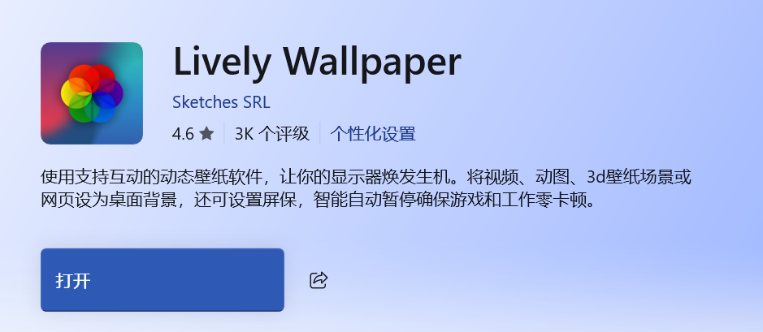

# Desktop Dock 使用说明

适用：Windows 11 22H2 或更新版本，x64，主显示器。
当前为测试版。完整多屏、ARM64 和所有第三方任务栏工具组合尚未验证。

## 下载与安装

只从官方发布页下载：
https://github.com/lpd2005/desktop-dock/releases

推荐下载 DesktopDock-版本号-Setup-x64.exe，双击后按提示安装。
默认安装到当前用户的应用目录，无需管理员权限，自带 .NET 运行环境。
开始菜单中提供程序、设置和本说明；Windows“已安装的应用”中可以卸载。
安装包暂未使用代码签名证书，Windows 可能显示发布者未知。请核对发布来源。

不想安装时，可下载 win-x64.zip 便携包。必须完整解压后启动 DesktopDock.exe，
不要在压缩软件内部直接运行，也不要只复制 EXE。便携目录移动后需重新设置自启。

## 配合壁纸软件进行美化

从微软商店下载即可

想要好看的壁纸：https://haowallpaper.com/
在该网站直接下载壁纸，通过壁纸软件添加。

**注意** 这个软件后台消耗内存约为 **130M**

此处指壁纸软件的使用观察值，实际占用取决于壁纸内容与设置，不计入 Dock 单进程占用。

## 第一次使用与开机自启

安装结束后可打开“启动与更新”设置，按需启用“登录 Windows 后自动启动”。
自启仅针对当前 Windows 用户，不申请管理员权限，不提高系统进程优先级。
Windows 决定登录启动项的调度时间；软件会短暂等待资源管理器就绪。
默认不自动启用自启。若在任务管理器或 Windows 设置中禁用了启动项，
请在 Windows“启动应用”中重新开启。软件不会擅自覆盖系统的禁用选择。

正常运行会按设置隐藏桌面图标，托盘图标会一直保留。
Dock 看不到时，将鼠标移到主屏最底边并停留片刻即可唤出。

### 建议

如果当前 Windows 环境或现有任务栏工具提供顶部位置选项，可先将主屏任务栏设置到顶部，再启用 Dock 的顶部任务栏增强。不同环境的设置入口可能不同；Dock 不提供搬移原生任务栏的功能，没有顶部选项时也可以正常使用底部 Dock。

## Dock 操作

- 未运行应用：双击图标启动；已运行应用：单击显示，再次单击最小化。
- 鼠标悬停已运行应用约 0.4 秒可查看窗口预览，点击缩略图切换窗口。
- 多窗口预览支持滚轮和按钮翻页，鼠标停在卡片上会单独高亮。
- 桌面快捷方式、应用或文件夹可拖入 Dock 固定。
- 拖动 Dock 内图标排序；拖远出现红色垃圾桶，松手仅移除入口，不删除原文件。
- 右键图标可以打开、请求关闭窗口或移除入口。未保存内容由原应用处理。
- 最左侧九宫格打开桌面面板，可搜索、翻页和分组，不移动原文件。
- 最右侧齿轮或托盘菜单打开设置。支持减少动画、自动隐藏、预览开关等。

## 小组件与顶部任务栏

时间和天气组件可以分别开启、关闭和拖动，天气城市可手动修改，不自动定位。
天气来自 Open-Meteo；网络失败时保留上一次真实数据。

顶部原生任务栏增强默认关闭。只有已经把主屏任务栏设在顶部时才启用。
软件不会移动原生任务栏。正常退出、关闭增强或使用恢复命令会恢复状态。

## 更新软件

进入“设置 → 启动与更新 → 软件更新”，点击“检查更新”。
发现新版本后，点击“下载更新”，校验完成再点击“安装并重启”。
软件会退出并恢复桌面状态，随后由安装向导完成升级；保留原有用户配置。
安装完成后可勾选启动程序。取消安装后，可从开始菜单重新启动原版本。

默认自动检查更新，每天最多一次；可关闭，不会自动下载或执行安装程序。
测试版可接收后续测试版和正式版；正式版默认只接收正式更新。
更新依据正式发布的 Releases，单纯推送源码不会触发用户安装更新。
网络受限或 GitHub 限流时，可稍后重试或从官方发布页手动下载安装包。

## 退出、恢复与卸载

正常退出请使用托盘中的“退出并恢复桌面”，原桌面图标和任务栏会恢复。
异常结束后，可运行包内“恢复桌面.cmd”或“恢复任务栏.cmd”。
也可在安装目录运行 DesktopDock.exe --recover。

卸载请使用 Windows“已安装的应用 → Desktop Dock → 卸载”。
卸载前程序会正常退出并恢复桌面状态，同时移除属于本安装的自启项。
卸载会保留用户配置，以便以后重装。

## 配置、隐私与问题反馈

用户配置在 %LOCALAPPDATA%\DesktopDock，安装程序在独立目录中。
更新不覆盖配置。不会上传应用列表、窗口标题、截图或个人桌面文件。
更新检查仅请求公开 GitHub 版本信息；天气仅发送填写的城市及查询坐标。

反馈问题：https://github.com/lpd2005/desktop-dock/issues
请提供程序版本、Windows 版本、显示缩放和复现步骤，提交前清除截图中的个人信息。

第三方组件许可证及 TranslucentTB 对应源码随运行包提供。
